<picture>
  <source media="(prefers-color-scheme: dark)" srcset="./assets/departures-board-dark.svg">
  
</picture>

<b>Aaryush Raj</b> · Student, UTU Server Mod/Administrator

    

**Itinerary.**  A B.Tech CSE student who enjoys building things, experimenting with technology, and figuring out how stuff works.

I enjoy learning by building, breaking things, and making them work better. Always curious, always experimenting.

**Now boarding:** Working on a Virtual Stream Deck.

#### Timetable

<picture>
  <source media="(prefers-color-scheme: dark)" srcset="./assets/departures-timetable-dark.svg">
  
</picture>

Reading the board

- **Departures** are featured repositories. Flight numbers come from your initials, **via** is the main language, and **stars** are the stars.
- **Now boarding** is what you are working on now.
- **The timetable** is the average number of contributions on each day of the week over the last twelve months; the amber row is the busiest day. On the right is the year in numbers.

Artwork: original animated SVG, generated by README Templates · template: Departures. Motion stops if your system asks for reduced motion.

#### Departures

- `AR101` **[Nexora-Discord-Quest-Spoofer](https://github.com/aaryush-exe/Nexora-Discord-Quest-Spoofer)** · Nexora is a lightweight Discord Quest Automation Tool   
  JavaScript · ★ 7
- `AR102` **[Vexryn](https://github.com/aaryush-exe/Vexryn)** · VALORANT companion UI prototype built with React, TypeScript and Tauri  
  CSS · ★ 6
- `AR103` **[Flicky](https://github.com/aaryush-exe/Flicky)** · Flicky – A modern Windows utility for effortless file conversion, compression, and extraction with a sleek, animated radial interface.  
  TypeScript · ★ 4
- `AR104` **[Scuba-Cat-Arduino-ESP32-Keyring-OLED-](https://github.com/aaryush-exe/Scuba-Cat-Arduino-ESP32-Keyring-OLED-)** · Scuba Cat keyring powered by an ESP32-C3 Super-Mini wiith an OLED display 🐱🤿 — a DIY Electronic gadget combining Cute Aesthetics with embedded electronics.  
  C · ★ 1

<picture>
  <source media="(prefers-color-scheme: dark)" srcset="./assets/departures-final-dark.svg">
  
</picture>

